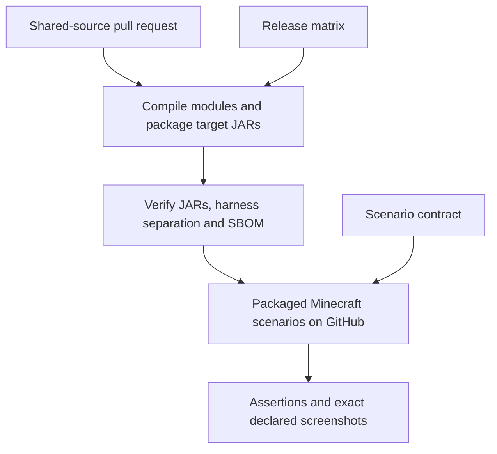

# Quick Skin

<!-- branch-profile:start -->
<!-- Generated by scripts/release/branch_readme.py from the release matrix. -->
Quick Skin is a client-and-server Minecraft mod for changing skins and capes in-game. It supports synchronized appearances, HD textures, animated capes and optional integrations.

[Modrinth](https://modrinth.com/mod/quick-skin) · [CurseForge](https://www.curseforge.com/minecraft/mc-mods/quick-skin)

## Shared multi-version source

Features and compatibility adapters compile as separate Gradle modules. The selected modules are assembled into one production JAR per Minecraft and loader target. `architecture/modules.json` owns module dependencies; `release/release-matrix.json` owns the targets currently configured in this checkout. Every configured target is listed with its loaders, Java version and current gate results under [Release status](#release-status); this profile does not repeat that inventory.

All targets build from the same source revision. Publication identity remains per Minecraft version (`mc<version>-v<mod_version>`); the complete build bundle is not a publishable release. Dependency ranges remain in the matrix and generated JAR metadata.

The [migration plan](docs/architecture/MODULAR-REWORK.md) records remaining API, selective CI, governance and evidence work. The status table derives its rows from this same matrix.
<!-- branch-profile:end -->

## Release status

The shared gates verify the configured matrix. Each Minecraft target is released independently.

<!-- release-status:start -->
<!-- Generated by scripts/release/status_table.py; do not edit this block manually. -->
All targets use [`master`](https://github.com/The-Plum-Team/Quick-Skin-Mod/tree/master). These badges report the shared source gates:

[](https://github.com/The-Plum-Team/Quick-Skin-Mod/actions/workflows/build-gate.yml?query=branch%3Amaster) [](https://github.com/The-Plum-Team/Quick-Skin-Mod/actions/workflows/on-demand-e2e.yml?query=branch%3Amaster)

Each row reports that target's Build and E2E jobs, including shared prerequisites. Snapshots update on CI transitions; caching may delay the displayed badges. Open a badge for its covered commit, observation time and original execution.

Check [GitHub Releases](https://github.com/The-Plum-Team/Quick-Skin-Mod/releases) for published downloads.

| Minecraft | Loaders | Java | Build | E2E |
|---|---|---:|:---:|:---:|
| 26.3 | Fabric + NeoForge | 25 | [](https://github.com/The-Plum-Team/Quick-Skin-Mod/blob/automation/ci-status/targets/26.3.md#build) | [](https://github.com/The-Plum-Team/Quick-Skin-Mod/blob/automation/ci-status/targets/26.3.md#e2e) |
| 26.2 | Fabric + NeoForge | 25 | [](https://github.com/The-Plum-Team/Quick-Skin-Mod/blob/automation/ci-status/targets/26.2.md#build) | [](https://github.com/The-Plum-Team/Quick-Skin-Mod/blob/automation/ci-status/targets/26.2.md#e2e) |
| 26.1.2 | Fabric + NeoForge | 25 | [](https://github.com/The-Plum-Team/Quick-Skin-Mod/blob/automation/ci-status/targets/26.1.2.md#build) | [](https://github.com/The-Plum-Team/Quick-Skin-Mod/blob/automation/ci-status/targets/26.1.2.md#e2e) |
| 26.1.1 | Fabric + NeoForge | 25 | [](https://github.com/The-Plum-Team/Quick-Skin-Mod/blob/automation/ci-status/targets/26.1.1.md#build) | [](https://github.com/The-Plum-Team/Quick-Skin-Mod/blob/automation/ci-status/targets/26.1.1.md#e2e) |
| 26.1 | Fabric + NeoForge | 25 | [](https://github.com/The-Plum-Team/Quick-Skin-Mod/blob/automation/ci-status/targets/26.1.md#build) | [](https://github.com/The-Plum-Team/Quick-Skin-Mod/blob/automation/ci-status/targets/26.1.md#e2e) |
| 1.21.11 | Fabric + NeoForge | 21 | [](https://github.com/The-Plum-Team/Quick-Skin-Mod/blob/automation/ci-status/targets/1.21.11.md#build) | [](https://github.com/The-Plum-Team/Quick-Skin-Mod/blob/automation/ci-status/targets/1.21.11.md#e2e) |
| 1.21.10 | Fabric + NeoForge | 21 | [](https://github.com/The-Plum-Team/Quick-Skin-Mod/blob/automation/ci-status/targets/1.21.10.md#build) | [](https://github.com/The-Plum-Team/Quick-Skin-Mod/blob/automation/ci-status/targets/1.21.10.md#e2e) |
| 1.21.9 | Fabric + NeoForge | 21 | [](https://github.com/The-Plum-Team/Quick-Skin-Mod/blob/automation/ci-status/targets/1.21.9.md#build) | [](https://github.com/The-Plum-Team/Quick-Skin-Mod/blob/automation/ci-status/targets/1.21.9.md#e2e) |
| 1.21.8 | Fabric + NeoForge | 21 | [](https://github.com/The-Plum-Team/Quick-Skin-Mod/blob/automation/ci-status/targets/1.21.8.md#build) | [](https://github.com/The-Plum-Team/Quick-Skin-Mod/blob/automation/ci-status/targets/1.21.8.md#e2e) |
| 1.21.7 | Fabric + NeoForge | 21 | [](https://github.com/The-Plum-Team/Quick-Skin-Mod/blob/automation/ci-status/targets/1.21.7.md#build) | [](https://github.com/The-Plum-Team/Quick-Skin-Mod/blob/automation/ci-status/targets/1.21.7.md#e2e) |
| 1.21.6 | Fabric + NeoForge | 21 | [](https://github.com/The-Plum-Team/Quick-Skin-Mod/blob/automation/ci-status/targets/1.21.6.md#build) | [](https://github.com/The-Plum-Team/Quick-Skin-Mod/blob/automation/ci-status/targets/1.21.6.md#e2e) |
| 1.21.5 | Fabric + NeoForge | 21 | [](https://github.com/The-Plum-Team/Quick-Skin-Mod/blob/automation/ci-status/targets/1.21.5.md#build) | [](https://github.com/The-Plum-Team/Quick-Skin-Mod/blob/automation/ci-status/targets/1.21.5.md#e2e) |
| 1.21.4 | Fabric + NeoForge | 21 | [](https://github.com/The-Plum-Team/Quick-Skin-Mod/blob/automation/ci-status/targets/1.21.4.md#build) | [](https://github.com/The-Plum-Team/Quick-Skin-Mod/blob/automation/ci-status/targets/1.21.4.md#e2e) |
| 1.21.3 | Fabric + NeoForge | 21 | [](https://github.com/The-Plum-Team/Quick-Skin-Mod/blob/automation/ci-status/targets/1.21.3.md#build) | [](https://github.com/The-Plum-Team/Quick-Skin-Mod/blob/automation/ci-status/targets/1.21.3.md#e2e) |
| 1.21.2 | Fabric + NeoForge | 21 | [](https://github.com/The-Plum-Team/Quick-Skin-Mod/blob/automation/ci-status/targets/1.21.2.md#build) | [](https://github.com/The-Plum-Team/Quick-Skin-Mod/blob/automation/ci-status/targets/1.21.2.md#e2e) |
| 1.21.1 | Fabric + NeoForge | 21 | [](https://github.com/The-Plum-Team/Quick-Skin-Mod/blob/automation/ci-status/targets/1.21.1.md#build) | [](https://github.com/The-Plum-Team/Quick-Skin-Mod/blob/automation/ci-status/targets/1.21.1.md#e2e) |
| 1.20.1 | Fabric + Forge | 17 | [](https://github.com/The-Plum-Team/Quick-Skin-Mod/blob/automation/ci-status/targets/1.20.1.md#build) | [](https://github.com/The-Plum-Team/Quick-Skin-Mod/blob/automation/ci-status/targets/1.20.1.md#e2e) |
<!-- release-status:end -->

[Project hub](https://the-plum-team.github.io/Quick-Skin-Mod/) ·
[Visual E2E gallery](https://the-plum-team.github.io/Quick-Skin-Mod/e2e/) ·
[Machine-readable gallery inventory](https://the-plum-team.github.io/Quick-Skin-Mod/e2e/gallery-data.json)

The site is built by the pinned [mod-base](https://github.com/The-Plum-Team/mod-base) kit from
authenticated packaged-E2E evidence; its inventory is a `mod-base.gallery` version 1 document, and
`build.json` names the exact Quick Skin and mod-base commits that rendered it
([ADR 0010](docs/architecture/decisions/0010-delegate-public-evidence-to-mod-base.md)).

## E2E validation flow

A pull request builds the configured Minecraft/loader targets from one source revision. The build
and packaged-runtime workflows derive their lanes from `release/release-matrix.json`; scenario
steps, assertions and screenshots come from `e2e/scenario-contract.json`.



The module graph also drives feature selection before screenshots are generated. It includes
transitive consumers, runtime bindings, setup and comparison dependencies. Local selection can
exercise just the HUD's disabled/enabled pair or the menu integration's own checkpoints. Shared
rendering/API changes reach their consumers; unknown impact uses full coverage.

Protected CI admits that reduced scope only after authenticating a complete healthy baseline,
exact ancestry and unchanged module fingerprints. Unproven impact, a change that can move
optional-mod compatibility evidence, and releases keep the complete profile. See the
[modular migration plan](docs/architecture/MODULAR-REWORK.md) for measured results and unfinished
gates. Routine new image E2E runs on GitHub during this migration; local compile results do not
certify those images. Version-branch synchronization is retired under the shared-source matrix.

## Features

- Change skins and capes from the title screen or pause menu.
- Import PNG, WebP, and JPEG skins, including HD skins up to 2048x1024.
- Import static and animated capes, with server-configurable change cooldowns.
- Choose automatic, classic, or slim player models.
- Preview appearances in an interactive 3D player widget.
- Synchronize Quick Skin appearances between players who run Quick Skin when the mod is also
  installed on the server.
- Pick a cosmetic nickname for roleplay by clicking your name above the model in the skin menu;
  admins can give players nicknames, or random names for a game, with commands.
- As an admin, give players a skin for now (yours, from the server's pool, random or swapped) from
  the Player skins panel in the settings' Server tab or with commands, for games and roleplay.
- See what you wear and hold on the skin menu's and pause menu's model, and click a piece of
  armour there to hide it from everyone, players without Quick Skin included.
- Use optional integrations with Customizable Player Models (`.cpmmodel`), Ears, 3D Skin Layers,
  CustomNPCs, Essential, ReplayMod, FancyMenu (whose layouts can hide, move, and resize the
  title and pause player preview) and JourneyMap (whose player icons show the Quick Skin face)
  when the matching third-party mod is installed.

Quick Skin does not declare these integrations as required dependencies. If an optional mod or API
is unavailable, its integration disables itself and normal skin/cape behavior remains available.
Player Armor Stands is not a supported Quick Skin integration.

## Current branch build matrix

The generated [shared-source table](#shared-multi-version-source) above comes from the
checked-in release matrix. Each row builds from this same modular source tree.

Every artifact targets exactly the Minecraft version printed in its filename and metadata. No active
artifact advertises a wider compatibility range.

## Installation

Choose the jar whose Minecraft version and loader match your instance. Quick Skin also requires:

- Architectury API for the selected Minecraft version and loader.
- Fabric API on Fabric.
- Forge when using the Forge artifact.
- NeoForge when using the NeoForge artifact.

Install Quick Skin on the client for local appearance management. Install it on the server as well when you want Quick Skin appearance synchronization, shared texture transfer, or server-enforced cooldowns.

Server administrators can limit the size of each synchronized skin or cape with
`maxTextureUploadKilobytes` in `config/quickskin-server.json`: 64 to 16384 KiB, default 16384.
Edit the file while the server is stopped, because the server reads it at startup and writes its
settings back when it stops. A value outside that range is clamped, and a file that cannot be
parsed is left as it is while the defaults apply. Players with a skin or cape over the limit keep
it on their own screen and see a chat message; the rest of their appearance still syncs. Players
on Quick Skin 3.1.0 or older are the exception: while one of their textures is over the limit,
their whole appearance (skin, cape and model) does not sync until they update or choose a smaller
texture, and the server cannot change that. Lower the limit only when those players can update.

A server with Quick Skin tells each player who joins without it, once per world, that the server
uses Quick Skin and where to get it: one chat message in the language of their game, beside a
little pixel-art Plum, with a link to the Modrinth page. A minute after the join, so a client that does run Quick Skin has time to
say so; Bedrock players joining through Geyser are not told, since they cannot install it. In
`config/quickskin-server.json`, `notifyPlayersWithoutQuickSkin` turns it off,
`playersWithoutQuickSkinMessage` replaces the text (the link follows it) and
`playersWithoutQuickSkinLink` changes the link (an `http` or `https` address; empty sends no
link). The players already told are listed in the world's `quickskin/missing_mod_notices` folder;
delete a player's file there to tell them again.

Players who do not run Quick Skin never see a Quick Skin appearance, even on a server that has
Quick Skin. An unmodded client only shows a skin that Mojang hosts and signs, so those players see
your Mojang account skin, or a default skin on an offline-mode server. With a paid account on an
online-mode server you can change your account skin from Quick Skin: hover a skin in the Quick Skin
menu and press the ↑ button (Upload to Mojang). Quick Skin never uploads a skin unless you press it.
Mojang accepts only standard 64x64 or legacy 64x32 skins; custom capes, HD skins and CPM models
stay visible only to players who run Quick Skin.

Other players without Quick Skin see the new account skin after you rejoin the server (if you host
a LAN world, restart the game instead). An online-mode server that runs Quick Skin can show it to
them without a rejoin: set `"shareAccountSkinWithVanillaClients": true` in
`config/quickskin-server.json` and restart the server. After each upload the server then reads your
newly signed skin from Mojang's session server, usually within a minute or two, and refreshes you
for the players without Quick Skin. The option is off by default. It has no effect on an
offline-mode server, including a backend behind a BungeeCord or Velocity proxy (the backend runs
in offline mode), or on a server that logs players in through another service than Mojang's
(authlib-injector, Ely.by, LittleSkin, Drasl or custom `minecraft.api.*` hosts); the server log
says so. The upload dialog tells you which case applies to the server you are on.

With the option on, a skin plugin such as SkinsRestorer is overridden for players without Quick
Skin after each upload, until it applies its own skin again. The refresh briefly removes and
re-adds you in those players' tab list; a vanish mod that filters player-list packets keeps you
hidden, but one that does not could reveal you, so leave the option off on such servers. See
[ADR 0011](docs/architecture/decisions/0011-show-quick-skin-appearances-only-to-quick-skin-clients.md)
and [ADR 0012](docs/architecture/decisions/0012-share-uploaded-account-skins-with-unmodded-players.md).

### Nicknames

Click your name above the model in the skin menu to pick a nickname, a purely cosmetic name for
roleplay; "Use My Name" removes it. It is kept per launcher account. A server that runs Quick Skin
shows it to everyone, with or without Quick Skin, in chat, death and advancement messages and the
tab list, and announces each change. The join and leave messages show both names, "Nick (Account)
joined the game", and operators (permission level 2) also see the account name in the tab list.
Commands, selectors and tab completion keep using account names, and hovering a name in chat
still shows it. Players with Quick Skin also see nicknames on name tags; players without it see
account names above heads.

Because Minecraft announces a player before their client can send anything, the server remembers
nicknames per world (`quickskin/nicknames.json`): the first join after you choose one still shows
the previous name, followed by the announcement. A nickname holds up to 32 letters (any script),
digits, spaces and `_ - . , '`, and it can change every 10 seconds. It may not read like (ignoring
case, accents and look-alike letters) the name of a player online, an operator or a whitelisted
player, nor the name or nickname of anyone who joined the world before; a nickname that reads like
a player's name is cleared when that player joins. Server owners stop players from choosing
nicknames with `"allowNicknames": false` in `config/quickskin-server.json`; names an admin gives
still show. A mod that sets its own tab-list names (TAB, Styled Player List) keeps them. See
[ADR 0015](docs/architecture/decisions/0015-show-cosmetic-nicknames-through-display-names.md).

Admins (permission level 2) manage nicknames with commands, which target account names and
selectors as usual:

| Command | Effect |
|---|---|
| `/quickskin nickname set <player> <nickname>` | Gives the player that nickname for now: it shows instead of their own until taken back, and they cannot change theirs meanwhile. |
| `/quickskin nickname random <players>` | Gives each player a different name from `config/quickskin-nicknames.txt`, for a game where nobody should know who is who. |
| `/quickskin nickname reset [players]` | Takes back the names an admin gave; players show their own nickname again. With no players, of everyone, also of players who are not online, whose names are then free again. |
| `/quickskin nickname clear <players>` | Removes every nickname the players have, so their account names show. |
| `/quickskin nickname lock <players>` / `unlock <players>` | Stops, or lets again, players change their own nickname. |

Only the player and the operators hear about a name an admin gives, so a round of a game can hand
out names without announcing who is who; the operators still see the account names in the tab
list. Names an admin gives follow the same rules, without the 10-second wait. The server writes
`config/quickskin-nicknames.txt` with about ninety given names that suit anyone the first time it
starts; edit it freely (one name per line, `#` starts a comment), for example with the NATO
alphabet for code names. To clear a player's nickname for good, run `clear` and then `lock`.

### Player skins (admins)

Admins (permission level 2) can give players a skin for now, which other players with Quick Skin
see instead of theirs until it is taken back; the players see it on themselves too, and what
they pick in the skin menu meanwhile shows once it is taken back. In the settings, the Server tab's
Player skins row opens a panel, for admins on a server that hands out skins: pick players on the
left, then click one of your skins, or a skin of the server's pool, to give it to them.
Random gives each picked player a pool skin, Shuffle swaps their own skins so that nobody keeps
theirs, and Restore takes the given skins back. A skin's `+` adds it to the server's pool, a pool
skin's `×` removes it. The same works with commands, which take selectors:

| Command | Effect |
|---|---|
| `/quickskin skin set <players> <pool skin>` | Gives the players that pool skin for now. |
| `/quickskin skin copy <players> <player>` | Gives them the skin that player shows. |
| `/quickskin skin random <players>` | Gives each a random pool skin, all different while the pool has enough. |
| `/quickskin skin shuffle <players>` | Swaps their own Quick Skin skins among them. |
| `/quickskin skin reset [players]` | Takes the given skins back; with no players, everyone's, also of players who are not online. |
| `/quickskin skin pool list` / `add <name> <player>` / `remove <name>` / `reload` | Lists the pool, adds the skin a player shows, removes one, or reads the skin folder again. |

The server keeps the skins it gave and its pool per world (`quickskin/assigned-skins.json`), so
they last across reconnects and restarts until taken back. PNG skins (64x64 or an HD size) placed
in `config/quickskin-skins/` join the pool when the server starts or on `skin pool reload`, named
after their file; a name ending in `_slim` or `_classic` sets the arms, which are read from the
skin otherwise. The pool holds up to 64 skins. Players without Quick Skin keep seeing everyone's
Mojang skins, a CPM model stays the look of whoever wears one, and capes are not changed. See
[ADR 0016](docs/architecture/decisions/0016-assign-skins-over-players-own-appearances.md).

### Hidden armour

In a world, the skin menu's and the pause menu's model wear what you wear and hold: armour,
elytra, a worn head, the items in your hands and the accessories of Curios, Trinkets or
Accessories, such as Artifacts' gloves. Hovering a piece of armour on the skin menu's
model turns it into a see-through ghost, so you see your skin as hiding it would show it (a hidden
piece appears as the same ghost), as long as nothing stands in front of it, as your chest does of an
elytra; click it to hide it from everyone, and click it again to show it. Each piece
(helmet, chestplate or elytra, leggings and boots) hides on its own, and the choice is kept per
account. A hidden piece is still worn and protects as usual: the server leaves it out of the
equipment it sends other players, so nobody sees it, players without Quick Skin included, and you
no longer see it in third person, in your inventory or in the menus either. This needs Quick Skin
on the server; a server owner who prefers everyone's armour to show, for example for PvP, sets
`"allowHiddenArmor": false` in `config/quickskin-server.json`. See
[ADR 0017](docs/architecture/decisions/0017-hide-armour-pieces-from-everyone.md).

## Using Quick Skin

1. Open the Quick Skin menu from the title or pause screen, or bind its configurable key.
2. Import a skin or place it under `.minecraft/quickskin/skins/`.
3. Import a cape or place it under `.minecraft/quickskin/capes/`.
4. Select an appearance, preview it, and choose automatic, classic, or slim arms.

On Android launchers such as MJLauncher, Import opens a file browser inside Minecraft, starting
in the phone's Downloads folder. Use the Phone storage or Game folder buttons to choose another
location. Android may hide files in Downloads even when the folder itself is visible. Only files
the launcher can read are available; copy a missing file into the game folder using a file manager
that can access the launcher's storage. The underlined hint and matching Game folder label identify
this alternative; the chooser does not request Android storage permissions.

When CPM is installed, standalone models live under `.minecraft/player_models/` and can be imported as `.cpmmodel` files.

3D Skin Layers preview support follows the availability of the upstream mod for each loader. Entity previews are owned by the third-party renderer; Quick Skin supplies only the missing manual/title-screen preview path.

## Building

Build every matrix-declared production artifact and E2E harness, with unit tests:

```bash
python3 scripts/release/build_matrix.py
```

On Windows:

```powershell
python scripts/release/build_matrix.py
```

Launch Gradle with JDK 21 or newer because the Stonecutter build plugin requires it. Each produced
JAR targets the Java version declared for its artifact through Gradle's Java toolchain.
The coordinator starts one Gradle process per target, sequentially, to bound remapping memory.
Use `--clean` for a clean build or `--rerun-tasks` for the reproducibility rebuild. It does not
launch the image E2E suite. Build results are recorded in `build/matrix-build/results.json`;
stage and verify the JARs separately with `scripts/release/verify_release.py`.

To work on one Minecraft target, register only that target's modules and loaders:

```bash
./gradlew --no-parallel -PquickskinTarget=1.21.1 buildTargetLanes buildTargetE2EHarnesses
python3 scripts/release/verify_release.py --target 1.21.1 --stage build/target --manifest build/target/artifacts.json
```

The complete matrix is validated before filtering. Full-build tasks reject a target-scoped
invocation; a partial stage retains the complete matrix hash and its own publication identity.
See [adding a Minecraft target](docs/architecture/ADDING-MINECRAFT-TARGET.md) for the shared-source
workflow and the remaining migration boundaries.

Production jars are written under the selected module and version node, for example:

```text
fabric/versions/1.20.1/build/libs/
forge/versions/1.20.1/build/libs/
```

Development launches can use the same target scope:

```bash
./gradlew -PquickskinTarget=1.20.1 :fabric:1.20.1:runClient
./gradlew -PquickskinTarget=1.20.1 :forge:1.20.1:runServer
```

The aggregate build intentionally runs with `org.gradle.parallel=false`; Architectury's transformers use JVM-global properties and concurrent transforms are not safe.

Each production artifact has a separate test harness JAR, installed beside the exact staged mod.
See [Packaged-runtime E2E](e2e/README.md) for the matrix-derived gate and local commands.

## Source layout

- `architecture/modules.json` owns the separately compiled feature/API modules and their dependencies.
- `modules/` contains feature implementations; `common/` assembles them and owns runtime wiring.
- Loader directories own their entrypoints and loader-specific bridges.
- Matrix-routed overlays isolate API-family replacements within their owning module.
- `PreviewRenderBackend`, `GuiCompat`, `NetworkTransport`, `MinecraftCompat`, and `PlatformHelper` define the cross-version seams.
- Copy-based `src/v*` snapshots are retired; matrix validation rejects their reintroduction. Their preserved reference and resource-routing plan are documented in [Migration oracle retirement](ORACLE-RETIREMENT.md).

The [modular migration plan](docs/architecture/MODULAR-REWORK.md) tracks consolidation into
`master`. [Version branches](VERSION-BRANCHES.md) preserves the historical delivery flow.
Shared source does not create new version-port work.

Maintainer releases use one matrix-derived identity, exact-byte marketplace reconciliation,
artifact attestations, and an immutable GitHub Release. The retry and governance procedure is in
[Releasing Quick Skin](RELEASING.md).

## Historical documentation

- [Migration oracle retirement](ORACLE-RETIREMENT.md) records the preservation tag and post-retirement source policy.

## Contributing

Contributions are welcome, including from people using a coding assistant and encountering the
project for the first time. Start with [CONTRIBUTING.md](CONTRIBUTING.md) for branch selection,
safe AI prompting, source ownership, tests, commits, updates, and the pull-request checklist.

Bug reports and feature ideas are just as useful, so open an issue if something is broken. Coding
agents begin at [AGENTS.md](AGENTS.md), the import-only manifest for the focused AI instructions.

## License

**All rights reserved** — the source is public, but this is not open source.

You are welcome to read the code, build it for your own use, and fork it to
send pull requests back here. You may not reupload, mirror or redistribute the
mod, publish modified versions of it, or reuse the code in another project.

The only official downloads are [Modrinth](https://modrinth.com/mod/quick-skin),
[CurseForge](https://www.curseforge.com/minecraft/mc-mods/quick-skin) and this
repository. Anything else is a reupload.

Need permission for something not covered here? Ask — reasonable requests are
usually granted. Full terms in [LICENSE](LICENSE).
